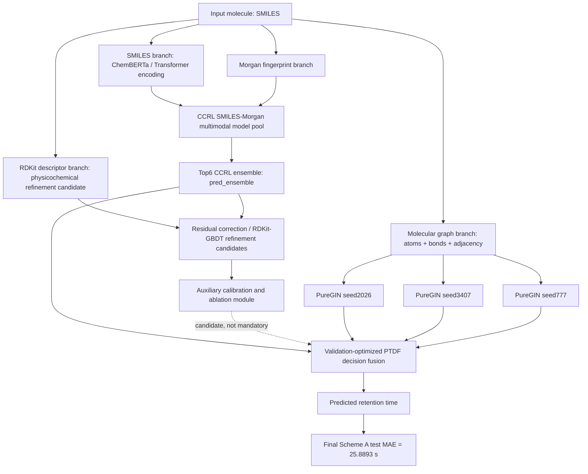

# Model Mechanism



## Core Idea

The final system uses complementary molecular representations:

- SMILES semantic representation from ChemBERTa-style sequence encoding.
- Morgan fingerprint representation for local circular substructures.
- Molecular graph representation for atom-bond topology.
- RDKit physicochemical descriptors as optional residual refinement candidates.

The CCRL SMILES-Morgan models remain the neural backbone. The Top6 CCRL ensemble provides the final base branch through `pred_ensemble`. Three PureGIN graph models provide complementary topological predictors.

## Final PTDF Definition

PTDF is now defined as validation-optimized decision fusion:

```text
CCRL ensemble
+ physicochemical refinement candidates
+ topological GNN predictors
-> validation optimized decision fusion
-> RT prediction
```

The final deployed Scheme A uses:

```text
y_RT =
0.30 * CCRL pred_ensemble
+ 0.24 * PureGIN seed2026
+ 0.18 * PureGIN seed3407
+ 0.28 * PureGIN seed777
```

Residual correction is retained as a physicochemical residual refinement module and ablation analysis, not as the final mandatory base.
